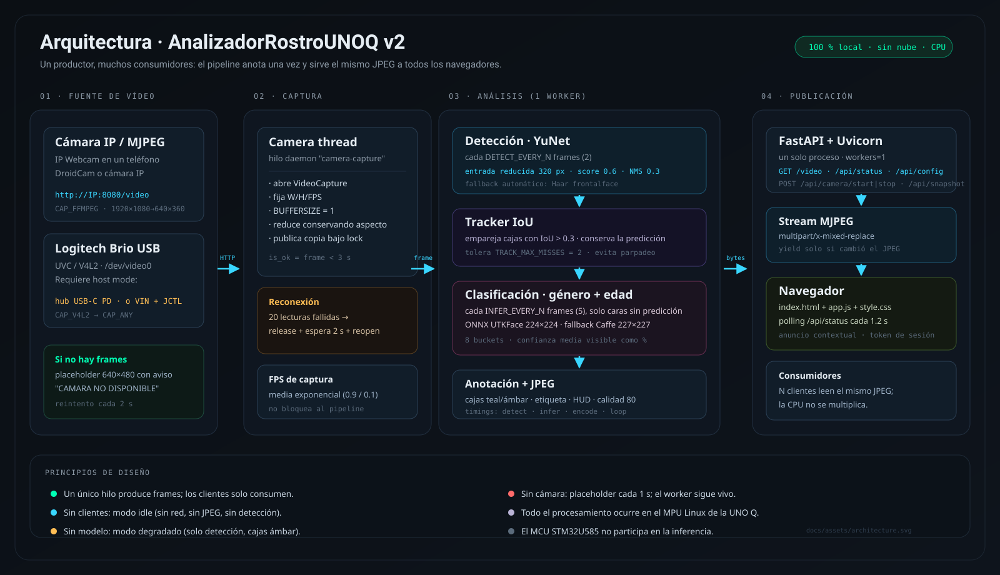

# AnalizadorRostroUNOQ v2

<p align="center">
  
  
  
  
  
  
  
</p>

> **Versión 2 (V2), proyecto separado de V1.** Corre en el puerto **8001** y usa
> **YuNet** para detectar rostros, un tracker IoU y ciclos separados de detección
> y clasificación. V1 queda intacto en su carpeta y en el puerto 8000. Ver
> [`docs/V2.md`](docs/V2.md) para el detalle de los cambios y el benchmark.

**Detección de rostros y estimación de género + rango de edad en la Arduino UNO Q, con interfaz web en español y procesamiento 100 % local.**

Aplicación **Python / FastAPI** que corre en el **MPU Linux (Qualcomm QRB2210, ARM64, Debian)** de la Arduino UNO Q. Captura vídeo de una **Logitech Brio USB** o de una **cámara IP/MJPEG por WiFi** (por ejemplo, IP Webcam en un teléfono), detecta rostros con **YuNet** (con fallback a Haar) y clasifica **género** y **rango de edad** con uno de dos backends: un modelo **ONNX propio entrenado con UTKFace** o el **fallback Caffe de Levi & Hassner**. El vídeo anotado se sirve como **stream MJPEG** a cualquier navegador de la red local.

> **No es un sketch `.ino`.** Este proyecto no se compila con `arduino-cli` ni ejecuta inferencia en el MCU STM32U585. Todo el runtime vive en el lado Linux de la placa. Ver [¿Por qué no se usa arduino-cli?](#por-qué-no-se-usa-arduino-cli).

---

## Tabla de contenidos

1. [Estado del proyecto](#estado-del-proyecto)
2. [Qué es y qué no es](#qué-es-y-qué-no-es)
3. [Arquitectura](#arquitectura)
4. [Principio de funcionamiento](#principio-de-funcionamiento)
5. [Hardware requerido](#hardware-requerido)
6. [Software requerido](#software-requerido)
7. [Puesta en marcha paso a paso](#puesta-en-marcha-paso-a-paso)
8. [Red de demo (router TP-Link)](#red-de-demo-router-tp-link)
9. [Recursos, "pinout" y conexión](#recursos-pinout-y-conexión)
10. [Configuración (.env)](#configuración-env)
11. [API HTTP](#api-http)
12. [Operación de la interfaz web](#operación-de-la-interfaz-web)
13. [Calibración y rendimiento](#calibración-y-rendimiento)
14. [Entrenamiento del modelo UTKFace](#entrenamiento-del-modelo-utkface)
15. [Ejemplos de uso realistas](#ejemplos-de-uso-realistas)
16. [Solución de problemas](#solución-de-problemas)
17. [Privacidad y datos biométricos](#privacidad-y-datos-biométricos)
18. [Limitaciones conocidas](#limitaciones-conocidas)
19. [Atribuciones y licencias](#atribuciones-y-licencias)
20. [Advertencias específicas de la UNO Q](#advertencias-específicas-de-la-uno-q)
21. [Estructura del repositorio](#estructura-del-repositorio)
22. [Documentación adicional](#documentación-adicional)

**Lecturas de portfolio:** [Cómo fue construido](#cómo-fue-construido) · [Referencias](#referencias) · [Diagramas vectoriales](#diagramas-vectoriales)

---

## Estado del proyecto

| Aspecto | Estado |
|---|---|
| Código de la aplicación | Completo; auditoría estática **APROBADA sin incidencias** (`AUDIT_REPORT.md`, ciclo 2). |
| Verificación en host | `py_compile` de todos los módulos, `bash -n` de los scripts, `node --check` del frontend y `train_utkface.py --self-test` (9/9) ejecutados correctamente según `AUDIT_REPORT.md`. |
| Modelos Caffe fallback | **Presentes localmente** en `models/fallback/` (~88 MB: `age_net.caffemodel` 45.7 MB, `gender_net.caffemodel` 45.6 MB, 2 prototxt). **Excluidos de Git** por `.gitignore`. |
| Modelo ONNX UTKFace | **Entrenado (v1.0.0)** con UTKFace y disponible como asset del release. Métricas de test: género **84.56 %**, edad exacta **48.17 %**, edad ±1 bucket **83.8 %**. El repositorio es **privado**: el asset requiere autenticación. En la placa ya está instalado; para un clon nuevo usá `gh release download` o copiá el `.onnx` por `scp`. No se versiona en Git. `MODEL_BACKEND=auto` lo prefiere sobre Caffe. |
| Despliegue en hardware | **Verificado en la UNO Q.** App instalada y corriendo como servicio `unoq-app-v2`; UI en `http://192.168.10.75:8001`, SSH 22/2222 y modelo ONNX cargado. La cámara validada fue **IP Webcam** (MJPEG por WiFi), no la Brio USB. |
| Rendimiento real | **Medido parcialmente** en QRB2210: stream IP Webcam 1920×1080 reducido a 640×360, ~15 fps en la UI, inferencia ONNX cada 5 frames. No se probó la Brio por USB: falta un hub USB-C con PD o el puente JCTL + alimentación por VIN. |

> **Honestidad técnica:** distinguimos métricas reales (test del modelo, verificación en placa) de cifras ilustrativas. Los ejemplos de JSON y las tablas de benchmark se rotulan como ilustrativos cuando no son una medición controlada.

---

## Qué es y qué no es

| ✅ Es | ❌ No es |
|---|---|
| Una app web autocontenida servida desde el MPU Linux de la UNO Q. | Un sketch Arduino / `.ino`. |
| Detección de rostros frontales con **YuNet** (fallback Haar cascade). | Un sistema de reconocimiento facial (no identifica personas). |
| Estimación de género binario y rango de edad en 8 buckets. | Un sensor de edad exacta ni una medición médica. |
| Inferencia local en CPU con OpenCV DNN (ONNX o Caffe). | Inferencia en el MCU STM32U585 / Zephyr / TensorFlow Lite Micro. |
| Stream MJPEG para varios navegadores con un solo worker. | Un servidor WebRTC, RTSP o HLS. |
| Snapshots **desactivados por defecto**. | Un sistema de videovigilancia con grabación continua. |

**Resultado esperado:** una página en `http://<IP_UNO_Q>:8001/` con el vídeo en vivo, cajas sobre los rostros y etiquetas del tipo `Femenino | 20-29 (84%)`, un contador de rostros y FPS.

---

## Arquitectura

```text
┌──────────────────────────────────────────────────────────────┐
│ NAVEGADOR (PC / móvil en la misma red)                        │
│  index.html + app.js + style.css                             │
│    ├──       stream MJPEG                   │
│    ├── GET  /api/status        polling cada 1.2 s             │
│    └── POST /api/snapshot|start|stop   (X-Api-Token opcional) │
└───────────────────────────┬──────────────────────────────────┘
                            │ HTTP :8001
┌───────────────────────────▼──────────────────────────────────┐
│ ARDUINO UNO Q — MPU Linux (Qualcomm QRB2210, ARM64, Debian)  │
│                                                              │
│  Uvicorn + FastAPI  (app/main.py)                            │
│    └── VideoPipeline: 1 hilo worker único                    │
│          frame → cada DETECT_EVERY_N: YuNet 320 px           │
│                → tracker IoU (conserva predicciones)         │
│                → cada INFER_EVERY_N: ONNX o Caffe            │
│                → overlay → JPEG → publica bajo lock          │
│    ├── Camera: hilo de captura V4L2/FFMPEG + reconexión      │
│    ├── FaceDetector: YuNet + fallback Haar + overlay         │
│    └── ModelHandle: ONNX UTKFace (224×224)                   │
│                     o Caffe Levi & Hassner (227×227)         │
│                     o modo degradado (solo detección)        │
│                                                              │
│  OpenCV VideoCapture(CAMERA_SOURCE o /dev/videoN)            │
└───────────────────────────┬──────────────────────────────────┘
                            │
          ┌─────────────────┴─────────────────┐
          │ WiFi (MJPEG/RTSP)                 │ USB (V4L2/UVC)
   ┌──────▼──────┐                    ┌───────▼────────┐
   │ IP Webcam   │                    │ Hub USB-C PD   │
   │ / cámara IP │                    │ + Brio         │
   └─────────────┘                    └────────────────┘

   El MCU STM32U585 (Zephyr) NO participa: no hay GPIO, ADC ni
   comunicación MCU↔MPU en esta versión.
```

<p align="center">
  <a href="docs/assets/architecture.svg"></a>
</p>

> Diagrama vectorial completo: [`docs/assets/architecture.svg`](docs/assets/architecture.svg). El pipeline en detalle, con la cadencia de detección/clasificación y el cálculo de IoU, está en [`docs/assets/pipeline.svg`](docs/assets/pipeline.svg).

### Módulos

| Archivo | Responsabilidad |
|---|---|
| `app/main.py` | App FastAPI, endpoints, worker de vídeo, generador MJPEG, control de cámara, snapshots. |
| `app/config.py` | Carga de `.env`, validación, rutas seguras, configuración pública. |
| `app/camera.py` | `cv2.VideoCapture` en hilo dedicado, reconexión, lectura thread-safe. |
| `app/detector.py` | YuNet (con fallback Haar), tracker IoU, ROI con margen, overlay de cajas/etiquetas/HUD. |
| `app/models_loader.py` | Backends ONNX y Caffe, preprocesado y contrato de predicción. |
| `python/main.py` | Entrypoint compatible con Arduino App Lab. |
| `static/` | UI sin build step (HTML + CSS + JS vanilla). |
| `training/` | Entrenamiento UTKFace fuera de la placa. |
| `scripts/` | Descarga de modelos, setup en placa, despliegue y arranque. |

---

## Principio de funcionamiento

1. **Arranque.** `load_settings()` lee `.env` y el entorno. `load_model()` intenta cargar el backend pedido (`auto` → ONNX → Caffe → ninguno). `FaceDetector` intenta crear `cv2.FaceDetectorYN` con `face_detection_yunet_2023mar.onnx`; si no puede, cae a `haarcascade_frontalface_default.xml` y lo informa en `/api/status` (`detector_backend: "haar"`).
2. **Captura.** `Camera` abre la fuente configurada. Si `CAMERA_SOURCE` contiene una URL (`http(s)://`, `rtsp://`, `rtmp://`) usa `CAP_FFMPEG`; si está vacío, abre `/dev/videoN` con `CAP_V4L2` (Linux) y, si falla, `CAP_ANY`. Fija resolución, FPS y `BUFFERSIZE=1` para minimizar latencia, y **reduce el frame conservando el aspecto** si la fuente entrega más píxeles de los pedidos (IP Webcam suele ignorar las propiedades y mandar 1920×1080). Un hilo guarda siempre el último frame y se reconecta si la fuente desaparece (20 lecturas fallidas → reapertura cada 2 s).
3. **Pipeline único.** `VideoPipeline` es el **único** hilo que lee cámara, detecta, clasifica, dibuja y codifica. Publica el último JPEG protegido por lock. Los clientes de `/video` solo copian ese JPEG: **N navegadores no multiplican la CPU**.
4. **Detección independiente.** Cada `DETECT_EVERY_N` frames —o antes si no hay ninguna cara— el frame se reduce a `YUNET_INPUT_WIDTH` (320 px por defecto), se pasa a YuNet con `score_threshold=0.6` y `nms_threshold=0.3`, y las cajas se escalan de vuelta a la resolución original. Si el detector activo es Haar, se usa gris + `equalizeHist` + `detectMultiScale(1.1, 5, (60,60))`. Cada caja se recorta con un **margen del 6 %** para incluir mentón/frente.
5. **Tracker IoU.** `IoUTracker.update()` empareja cada detección con el track anterior cuyo solapamiento supere `TRACK_IOU_THRESHOLD` (0.3). Si hay match, **conserva la última predicción** y solo actualiza la caja; si no, crea un track nuevo sin predicción. Un track desaparecido se conserva hasta `TRACK_MAX_MISSES` (2) frames. Esto evita que la etiqueta parpadee entre frames y permite clasificar mucho menos seguido.
6. **Clasificación separada.** Cada `INFER_EVERY_N` frames —o si alguna cara todavía no tiene predicción— cada ROI se envía al backend activo. Género se devuelve como `Masculino`/`Femenino`; edad como uno de los 8 buckets configurados. Si la confianza individual de una cabeza no supera `CONF_THRESHOLD`, la etiqueta conserva la clase estimada pero la prefija con `~` y la cierra con `?` (por ejemplo, `~20-29?`).
7. **Overlay y publicación.** Se dibujan cajas (teal si hay predicción, ámbar si no), etiqueta `Género | Edad (conf%)` y HUD `Rostros: N | FPS: x.x`. El porcentaje mostrado es el **promedio** de las confianzas de género y edad. El frame anotado se codifica a JPEG (`JPEG_QUALITY`, por defecto 80) y se publica; `/video` emite chunks `multipart/x-mixed-replace; boundary=frame` **solo cuando el JPEG cambió**.
8. **Reposo.** Si no hay clientes MJPEG, el worker entra en modo idle: lee la cámara cada 250 ms, **no ejecuta YuNet, ni el clasificador, ni codifica JPEG**. Esto mantiene el frame disponible para snapshots con CPU casi nula. Al conectarse un cliente, `add_client()` despierta al worker. Si no hay frame, publica un placeholder cada segundo y sigue vivo.

### Backends

| Backend | Entrada | Preprocesado | Salidas | Buckets de edad |
|---|---|---|---|---|
| `utkface_onnx` | 224×224 | `blobFromImage(face, 1/127.5, (224,224), (127.5,127.5,127.5), swapRB=True)` | `gender` sigmoide (0=M, 1=F), `age` softmax 8 | `AGE_BUCKETS` (configurable, 8 valores) |
| `caffe` | 227×227 | `blobFromImage(face, 1.0, (227,227), mean BGR, swapRB=False)` | `gender_net` 2 clases (0=M, 1=F), `age_net` 8 clases | **Fijos en código**: `0-2, 4-6, 8-12, 15-20, 25-32, 38-43, 48-53, 60-100` |
| `none` (degradado) | — | — | Etiqueta `Rostro detectado \| modelo no cargado` | — |

> ⚠️ Los buckets del modelo Caffe **no son** los de UTKFace. `AGE_BUCKETS` solo se aplica al backend ONNX. Si mezclas ambos verás rangos distintos en pantalla.

---

## Hardware requerido

| Elemento | Detalle |
|---|---|
| **Arduino UNO Q** | MPU Qualcomm QRB2210, ARM64/AArch64, Debian Linux. Variante reportada por el usuario: **8 GB RAM**. |
| **Cámara** | **Opción recomendada:** cámara IP/MJPEG por WiFi (IP Webcam en un teléfono, DroidCam, cámara IP). **Opción USB:** Logitech Brio (UVC) o cualquier cámara V4L2 (`/dev/videoN`), pero requiere que la UNO Q esté en **host mode**. |
| **Hub USB** | Solo para la opción USB. Debe ser un **hub USB-C con entrada PD (Power Delivery)** y fuente externa: el hub alimenta la UNO Q y la cámara. Un hub USB-A “alimentado” no pone la UNO Q en host mode. |
| **Alimentación de la placa** | Fuente oficial de la UNO Q o hub USB-C PD. Si alimentás por VIN (7–24 V) y querés USB host, hay que puentear **JCTL** con la placa apagada. |
| **Red** | Wi-Fi o Ethernet en la UNO Q para abrir la UI desde otro equipo. |
| **Host de desarrollo** | PC Linux/macOS/Windows para editar y desplegar (ADB o SSH). No es imprescindible si trabajas directamente en la placa. |
| **Opcional: GPU** | Solo para entrenar el modelo UTKFace (Colab o PC). No se usa en la placa. |

### Especificaciones de la UNO Q relevantes

| Bloque | Detalle | ¿Se usa aquí? |
|---|---|---|
| MPU | Qualcomm QRB2210, ARM64, Debian | ✅ Todo el runtime |
| MCU | STM32U585 (Cortex-M33, TrustZone) | ❌ No |
| RTOS del MCU | Zephyr | ❌ No |
| GPIO del MCU | 3.3 V | ❌ No se conecta nada |
| ADC del MCU | 12 bits (0–4095) | ❌ No se usa |
| FQBN del MCU | `arduino:zephyr:unoq` | ❌ No aplica |
| Serie del MCU | `/dev/ttyACM0` | ❌ No requerido |
| Cámara | USB UVC → `/dev/video0` | ✅ |
| Servidor | TCP `0.0.0.0:8001` | ✅ |

---

## Software requerido

### En la placa (runtime)

| Componente | Versión / notas |
|---|---|
| Debian Linux del MPU | El que trae la UNO Q. |
| Python | **3.10 o superior** (NumPy 2.2 lo exige; en la placa validada corre el Python de Debian ARM64). |
| `python3-venv` | Necesario para crear `.venv`. Si falta, se instala con autorización explícita: `sudo apt-get install -y python3-venv python3-pip`. |
| Dependencias | `requirements.txt`: FastAPI, Uvicorn, OpenCV headless, NumPy, Pillow, python-dotenv, python-multipart. |
| `curl` | Para `scripts/download_fallback_models.sh`. |
| `adb` / `ssh` | Solo en el host que despliega. |

> `opencv-python-headless` evita dependencias gráficas (no hay servidor X en la placa). No cambies a `opencv-python` "normal" en la UNO Q.

### En el host de desarrollo

| Herramienta | Uso |
|---|---|
| `adb` | Despliegue por USB. |
| `ssh` + `rsync` (opcional) | Despliegue por red. |
| `python3` | Verificaciones de sintaxis en host. |
| Navegador moderno | UI (Chrome, Firefox, Safari, Edge). |

### Dependencias de Python (`requirements.txt`)

Las dependencias de runtime están fijadas en [`requirements.txt`](requirements.txt): FastAPI, Uvicorn, OpenCV headless, NumPy, Pillow, python-dotenv y python-multipart. Instalalas **siempre** dentro de un entorno virtual:

```bash
python3 -m venv venv
source venv/bin/activate        # Linux / macOS
venv\Scripts\activate           # Windows (cmd)
pip install -r requirements.txt
```

En la placa, `scripts/setup_board.sh` crea `.venv` y hace lo mismo de forma automática. Si actualizás dependencias, recreá el entorno antes de reportar un error de versiones:

```bash
rm -rf venv .venv
python3 -m venv venv
source venv/bin/activate
pip install -r requirements.txt
```

---

## Puesta en marcha paso a paso

### 0. Obtener el proyecto en el host

```bash
cd /ruta/a/tu/workspace
ls AnalizadorRostroUNOQ
```

### 1. Obtener los modelos

#### Opción A — Fallback Caffe (rápida, ya disponible localmente)

Los 4 archivos ya están en `models/fallback/` (~88 MB) pero **no se versionan**. Si clonas el repo en otro equipo:

```bash
cd AnalizadorRostroUNOQ
bash scripts/download_fallback_models.sh
```

Descarga desde `https://github.com/smahesh29/Gender-and-Age-Detection/raw/master` y valida que los `.caffemodel` superen 1 MB. Resultado esperado:

```text
age_net.caffemodel: 45661480 bytes
gender_net.caffemodel: 45649168 bytes
Modelos Caffe listos en /.../models/fallback
```

Con `MODEL_BACKEND=auto` (por defecto), la app usará Caffe si no existe el ONNX.

#### Opción B — Modelo propio UTKFace (ONNX, recomendado)

El modelo ya está entrenado y publicado como asset del release `v1.0.0`:

> **Repositorio privado.** El asset requiere autenticación. En la UNO Q ya está
> instalado. Para un clon nuevo, descargalo con una cuenta con acceso:

```bash
gh release download v1.0.0 \
  --repo wanderc137/AnalizadorRostroUNOQ \
  --pattern utkface_mobilenetv2.onnx \
  --dir models
```

O copiá `models/utkface_mobilenetv2.onnx` desde la placa por `scp`. El script
`scripts/download_model.sh` sigue sirviendo para una URL pública o un espejo:

```bash
cd AnalizadorRostroUNOQ
bash scripts/download_model.sh
# verifica tamaño y SHA256 antes de instalar
```

- **Release:** <https://github.com/wanderc137/AnalizadorRostroUNOQ/releases/tag/v1.0.0>
- **SHA256:** `390ade0e1f237616aca4636976f3223f1b8396e4bb539c27a4b55848a30c1661`
- **Tamaño:** 10,211,778 bytes (~9.8 MB).
- **Métricas de test (UTKFace, 2,371 imágenes):** género 84.56 %, edad exacta 48.17 %, edad ±1 bucket 83.8 %.
- **Entrada:** ONNX NCHW `[N,3,224,224]`, normalizada `x/127.5 - 1` con `swapRB=True`.

El `.onnx` **no se versiona** en Git (ver `.gitignore`). Para reentrenarlo:

```bash
cd training
pip install -r requirements-train.txt
python train_utkface.py --dataset-dir data/utkface --epochs 10 --batch-size 64 --output-dir output
cp output/utkface_mobilenetv2.onnx ../models/utkface_mobilenetv2.onnx
```

También puedes entrenar en GitHub Actions: el workflow está en
[`training/train-utkface.workflow.yml`](training/train-utkface.workflow.yml).
Cópialo a `.github/workflows/train-utkface.yml` en tu fork para ejecutarlo
(ver [`training/README.md`](training/README.md)).

### 2. Conectar la cámara

**Opción A — IP Webcam por WiFi (recomendada y ya validada):**

1. Instalá **IP Webcam** en el teléfono y pulsá **Start server**.
2. Dejá la app en primer plano, la pantalla encendida y la batería sin optimizar.
3. Anotá la URL que muestra, por ejemplo `http://192.168.10.249:8080`.
4. En la placa, poné esa URL en `CAMERA_SOURCE`:

```bash
CAMERA_SOURCE=http://192.168.10.249:8080/video
```

**Opción B — Brio USB con hub USB-C PD:**

```text
Fuente PD → hub USB-C (puerto PD)
Brio → USB-A del hub
Hub (USB-C upstream) → USB-C de la UNO Q
```

Verificá en la placa:

```bash
lsusb                         # debe aparecer Logitech
ls -l /dev/video*             # esperado: /dev/video0
```

> La UNO Q no alimenta la Brio por el USB-C en modo normal. Para USB hace falta
> host mode: hub USB-C con PD, o VIN 7–24 V + JCTL puenteado. Un hub USB-A
> alimentado no alcanza.

### 3. Desplegar el proyecto en la placa

#### Por ADB (USB)

```bash
adb devices
# Debe listar el dispositivo, p. ej.:
# List of devices attached
# <serial>    device

./scripts/deploy_unoq.sh --adb --setup --model
```

El script copia `app`, `python`, `static`, `scripts`, `training`, `models`, `requirements.txt`, `app.yaml` y `.env.example` a `/home/arduino/ArduinoApps/AnalizadorRostroUNOQ`, y luego ejecuta `scripts/setup_board.sh` en la placa.

> Si `adb devices` sale vacío o muestra `unauthorized`, ver [Solución de problemas](#solución-de-problemas). **Sin dispositivo enumerado no hay nada que desplegar.**

#### Por SSH (red)

```bash
export UNOQ_HOST=192.168.10.75
export UNOQ_USER=arduino            # valor por defecto del script
# export UNOQ_SSH_KEY=~/.ssh/unoq_key   # si usas clave
./scripts/deploy_unoq.sh --ssh --setup --model
```

#### Modo automático

```bash
./scripts/deploy_unoq.sh --setup --model
```

Intenta ADB; si falla, usa SSH (solo si `UNOQ_HOST` está definido).

> El despliegue **no copia `.env`** (está excluido en rsync; ADB tampoco lo incluye). `setup_board.sh` crea `.env` a partir de `.env.example` si no existe. Edita el `.env` de la placa para añadir `API_TOKEN`, cambiar `MODEL_BACKEND`, etc.

### 4. Preparar el entorno en la placa

Si no usaste `--setup`:

```bash
adb shell 'cd /home/arduino/ArduinoApps/AnalizadorRostroUNOQ && bash scripts/setup_board.sh'
# o, si quieres que además descargue el ONNX propio y Caffe en la placa:
adb shell 'cd /home/arduino/ArduinoApps/AnalizadorRostroUNOQ && bash scripts/setup_board.sh --with-model --with-models'
```

`setup_board.sh` es idempotente: crea `.venv`, actualiza `pip`, instala `requirements.txt`, copia `.env.example` → `.env` si falta y, con `--with-model`, descarga el ONNX UTKFace; con `--with-models`, descarga Caffe. Si el host ya tiene el ONNX, `deploy_unoq.sh --model` lo descarga antes de copiar y lo incluye en la transferencia.

### 5. Ejecutar

```bash
adb shell 'cd /home/arduino/ArduinoApps/AnalizadorRostroUNOQ && ./scripts/run.sh'
```

Salida esperada (ilustrativa):

```text
>> Iniciando AnalizadorRostroUNOQ con /home/arduino/ArduinoApps/AnalizadorRostroUNOQ/.venv/bin/python
INFO:     Started server process [1234]
INFO:     Waiting for application startup.
INFO:     Application startup complete.
INFO:     Uvicorn running on http://0.0.0.0:8001 (Press CTRL+C to quit)
2026-01-01 12:00:00,000 INFO analizador: Analizador listo en http://0.0.0.0:8001 (backend=caffe, camara=/dev/video0, auth=off)
```

> La app queda en primer plano. Para dejarla en segundo plano desde ADB, usa `nohup` (ver [Ejemplos de uso](#ejemplos-de-uso-realistas)). App Lab la gestiona por sí mismo si usas `app.yaml`, pero **el descriptor incluido mapea `8000:8000` y no es la vía validada**: el puerto real lo manda `.env` (`PORT=8001`). Si usás App Lab, ajustá el mapeo a `8001:8001` o cambiá `PORT`; no se validó en hardware.
>
> Si tras el `adb push` el bit de ejecución se perdió, arranca con `bash scripts/run.sh` en lugar de `./scripts/run.sh`.

#### Servicio systemd y scripts de arranque/parada

En la UNO Q la app corre como servicio `unoq-app-v2`. Los scripts de conveniencia están en la raíz del usuario:

```bash
~/start-server.sh
~/stop-server.sh
```

Equivalen a `sudo systemctl start unoq-app-v2` y `sudo systemctl stop unoq-app-v2`. El de arranque espera a que `/healthz` responda y muestra el estado de cámara, modelo y pipeline; el de parada espera hasta 5 s y systemd fuerza el cierre si quedan clientes MJPEG abiertos.

Desde el host:

```bash
ssh -p 22 -i ~/.ssh/unoq_key arduino@192.168.10.75 '~/start-server.sh'
ssh -p 22 -i ~/.ssh/unoq_key arduino@192.168.10.75 '~/stop-server.sh'
```

Los scripts usan el permiso acotado `/etc/sudoers.d/90-unoq-app-v2-control`, que solo permite iniciar/detener `unoq-app-v2`.

### 6. Abrir la interfaz

Averigua la IP de la placa:

```bash
adb shell 'hostname -I'
# o en la placa: ip -4 addr show
```

Abre en el navegador:

```text
http://192.168.10.75:8001/
```

Sustituye la IP por la real. La página muestra el stream, los badges de cámara/modelo, el contador de rostros y el panel de estado.

### 7. Alternativa: ejecutar en un PC para probar la UI

También puedes validar la app en tu equipo de desarrollo (con una webcam local):

```bash
cd AnalizadorRostroUNOQ
python3 -m venv .venv
source .venv/bin/activate
pip install -r requirements.txt
cp .env.example .env
python -m app.main
# abrir http://127.0.0.1:8001/
```

Si tu webcam no es el índice 0:

```bash
CAMERA_INDEX=1 python -m app.main
```

---

## Red de demo (router TP-Link)

Para demos en el cliente se usa una red local dedicada, sin internet y sin depender
de la red del lugar. El montaje completo está en
[`docs/demo-network.md`](docs/demo-network.md); acá va el resumen operativo.

```text
Notebook (cable) ──┐
                   ├── TP-Link TL-MR3420 v5 · OpenWrt 24.10.8
UNO Q (WiFi) ──────┤   LAN 192.168.10.1/24 · SSID "DEMO-UNOQ"
Teléfono (WiFi) ───┘   WAN sin conectar
```

| Recurso | Valor |
|---|---|
| SSID / clave | `DEMO-UNOQ` / `DemoUNOQ2026` (WPA2-PSK) |
| Panel del router | <http://192.168.10.1> |
| UNO Q | `192.168.10.75` fija · <http://192.168.10.75:8001> |
| Notebook | DHCP (`192.168.10.165` en la última prueba) |
| Teléfono (IP Webcam) | DHCP reservado `192.168.10.249` · `http://192.168.10.249:8080/video` |
| Pool DHCP | `192.168.10.100` – `192.168.10.249` |

> **Dos apps en la placa**: la **v1** (`unoq-app.service`, puerto **8000**,
> "Pipeline detenido") y la **v2** (`unoq-app-v2.service`, puerto **8001**). Para
> la demo, abrir siempre el **8001**.

La UNO Q guarda el perfil `DEMO-UNOQ` con IP fija y `autoconnect`, así que se
reconecta sola al encender. El perfil se crea con
[`scripts/demo-profile.sh`](scripts/demo-profile.sh). Para cambiar la IP fija de la
placa: [`scripts/set_static_ip.sh`](scripts/set_static_ip.sh).

Secuencia en el cliente:

1. Enchufar el router a 220 V y **esperar ~3 min** (el WiFi tarda en levantar).
2. Cable del notebook a un puerto **LAN**.
3. Encender la UNO Q **después** de que el WiFi del router quede estable.
4. Conectar el teléfono a `DEMO-UNOQ` y abrir IP Webcam.
5. Abrir `http://192.168.10.75:8001`.

> **Orden de encendido**: si la UNO Q arranca antes de que el router publique el
> WiFi, se conecta a otra red (p. ej. la de casa) y no vuelve sola. Encender el
> router y esperar ~3 min antes de la placa. Si ya pasó, forzar con
> `nmcli connection up DEMO-UNOQ`.

> La red demo **no tiene internet** (WAN desconectada). Si el notebook mantiene otra
> conexión, conserva internet por esa interfaz; el tráfico a `192.168.10.0/24` va
> por el cable.

---

## Recursos, "pinout" y conexión

Esta aplicación **no usa los pines GPIO del MCU**. El "pinout" relevante es el de **recursos del sistema Linux**.

### Tabla de recursos

| Recurso | Valor / dispositivo | Tipo | Notas |
|---|---|---|---|
| MPU Linux | Qualcomm QRB2210 ARM64 | Procesador | Ejecuta FastAPI, OpenCV y la inferencia. |
| MCU STM32U585 | Zephyr RTOS | MCU | **No se usa.** Sin firmware propio. |
| Cámara IP (recomendada) | IP Webcam / MJPEG por WiFi | Red | URL en `CAMERA_SOURCE`; no ocupa el USB-C. |
| Cámara USB | Logitech Brio (UVC) | USB | Requiere hub USB-C PD o VIN + JCTL para host mode. |
| Dispositivo de vídeo | `/dev/video0` o URL | V4L2 / FFmpeg | `CAMERA_INDEX=0` para USB; `CAMERA_SOURCE` para IP. |
| Backend de captura | `cv2.CAP_V4L2` / `cv2.CAP_FFMPEG` | Software | Fallback automático si el backend preferido no abre. |
| Puerto HTTP | `8001/tcp` | Red | `PORT=8001`. |
| Bind | `0.0.0.0` | Red | Expuesto a la LAN; protégete con `API_TOKEN`. |
| Stream MJPEG | `GET /video` | HTTP | `multipart/x-mixed-replace; boundary=frame`. |
| Snapshots | `SNAP_FOLDER` (vacío) | FS | Desactivados por defecto; deben quedar dentro del proyecto. |
| Carpeta en placa | `/home/arduino/ArduinoApps/AnalizadorRostroUNOQ` | FS | `REMOTE_APP_DIR` configurable. |
| Entorno Python | `.venv/` | FS | Creado por `setup_board.sh`. |
| Buckets de edad | 8 clases | Config | `AGE_BUCKETS` (solo ONNX). |

### Pines del MCU (no usados)

| Pin / bloque | Conexión | Estado |
|---|---|---|
| Headers digitales D0–D13 | — | Sin uso. |
| Headers analógicos A0–A5 | — | Sin uso (el ADC de 12 bits no interviene). |
| `LED_BUILTIN` (D13) | — | Sin uso; solo se menciona como posible evolución futura. |
| 3V3 / 5V / GND de headers | — | No se alimenta nada desde ellos. |
| `/dev/ttyACM0` | — | No se abre ni se requiere. |

> Si en el futuro quieres un LED de estado controlado por el MCU, necesitarás firmware Zephyr y un canal de comunicación MPU↔MCU (USB/serie). Eso **no** forma parte de este proyecto.

### Diagrama de conexión

**Opción A — cámara IP por WiFi (recomendada, ya validada):**

```text
┌──────────────────────┐        WiFi 2.4/5 GHz        ┌──────────────────────┐
│ Teléfono / cámara IP │ ───────────────────────────► │ Arduino UNO Q        │
│ IP Webcam :8080      │   MJPEG http://IP:8080/video │ Linux + OpenCV       │
└──────────────────────┘                              └──────────────────────┘
```

La UNO Q se alimenta con su fuente normal y no necesita host USB. Es la opción
que se probó en hardware: `CAMERA_SOURCE=http://192.168.10.249:8080/video`.

**Opción B — Brio USB con hub USB-C PD:**

```text
┌──────────────────────┐
│ Fuente USB-C PD      │
└──────────┬───────────┘
           │ alimenta al hub y a la placa
           ▼
┌──────────────────────┐        USB-A         ┌──────────────────────┐
│ Hub USB-C con PD     │ ◄─────────────────── │ Logitech Brio        │
│ (upstream USB-C)     │                      └──────────────────────┘
└──────────┬───────────┘
           │ USB-C (datos + alimentación)
           ▼
┌──────────────────────┐
│ Arduino UNO Q        │
│ host mode → /dev/video0
└──────────────────────┘
```

**Pasos para la opción B:**

1. Con la placa apagada, conectá la fuente PD al puerto **PD** del hub.
2. Conectá el USB-C upstream del hub al USB-C de la UNO Q.
3. Conectá la Brio a un USB-A del hub.
4. Encendé y esperá a que Linux enumere el dispositivo.
5. Verificá en la placa: `lsusb` debe mostrar `Logitech` y `ls -l /dev/video*` debe incluir `/dev/video0`.

> **Importante:** la UNO Q no pone el puerto USB-C en host mode solo por recibir
> 5 V. Necesita un hub USB-C con PD, o bien alimentación por VIN (7–24 V) con
> **JCTL** puenteado. Un hub USB-A con alimentación y un adaptador A-C no
> alcanzan. Documentación oficial:
> <https://docs.arduino.cc/tutorials/uno-q/host-mode>.

---

## Configuración (.env)

Copia `.env.example` a `.env` y ajusta. Los valores por defecto también están en `app/config.py`.

```bash
cp .env.example .env
```

| Variable | Defecto | Rango / valores | Descripción |
|---|---|---|---|
| `CAMERA_SOURCE` | vacío | URL `http(s)://`, `rtsp://`, `rtmp://` | Fuente de red (DroidCam, cámara IP). Tiene prioridad sobre `CAMERA_INDEX`. |
| `CAMERA_INDEX` | `0` | entero ≥ 0 | Índice de `/dev/videoN` (solo si `CAMERA_SOURCE` está vacío). |
| `WIDTH` | `640` | ≥ 64 | Ancho solicitado a la cámara. |
| `HEIGHT` | `480` | ≥ 64 | Alto solicitado. |
| `FPS_TARGET` | `15` | ≥ 1 | Ritmo objetivo del worker y de `CAP_PROP_FPS`. |
| `HOST` | `0.0.0.0` | IP | Bind de Uvicorn. |
| `PORT` | `8001` | 1–65535 | Puerto HTTP. |
| `MODEL_BACKEND` | `auto` | `auto`, `utkface_onnx`, `caffe` | Selección de backend. |
| `UTKFACE_ONNX_PATH` | `models/utkface_mobilenetv2.onnx` | ruta | Modelo propio. |
| `CAFFE_AGE_PROTO` | `models/fallback/deploy_age.prototxt` | ruta | Prototxt de edad. |
| `CAFFE_AGE_MODEL` | `models/fallback/age_net.caffemodel` | ruta | Pesos de edad. |
| `CAFFE_GENDER_PROTO` | `models/fallback/deploy_gender.prototxt` | ruta | Prototxt de género. |
| `CAFFE_GENDER_MODEL` | `models/fallback/gender_net.caffemodel` | ruta | Pesos de género. |
| `DETECTOR_BACKEND` | `auto` | `auto`, `yunet`, `haar` | `auto` usa YuNet si el modelo existe; si no, Haar. |
| `YUNET_MODEL` | `models/face_detection_yunet_2023mar.onnx` | ruta | Modelo YuNet (MIT). |
| `YUNET_SCORE_THRESHOLD` | `0.6` | 0.0–1.0 | Confianza mínima de detección. |
| `YUNET_NMS_THRESHOLD` | `0.3` | 0.0–1.0 | NMS de YuNet. |
| `YUNET_INPUT_WIDTH` | `320` | ≥ 64 | Ancho de detección; más bajo = más rápido. |
| `DETECT_EVERY_N` | `2` | ≥ 1 | Cada cuántos frames corre el detector. |
| `INFER_EVERY_N` | `5` | ≥ 1 | Cada cuántos frames corre la red de género/edad. |
| `TRACK_IOU_THRESHOLD` | `0.3` | 0.0–1.0 | Solapamiento mínimo para conservar una caja. |
| `TRACK_MAX_MISSES` | `2` | ≥ 0 | Detecciones perdidas antes de descartar una caja. |
| `CONF_THRESHOLD` | `0.6` | 0.0–1.0 | Umbral para mostrar género/edad o `?`. |
| `HAAR_PATH` | vacío | ruta | Vacío = cascade incluido en OpenCV. |
| `SNAP_FOLDER` | vacío | subcarpeta | Vacío = snapshots deshabilitados. |
| `SNAPSHOT_MIN_INTERVAL` | `2` | ≥ 0 s | Rate-limit entre snapshots (HTTP 429). |
| `AGE_BUCKETS` | `0-2,3-9,10-19,20-29,30-39,40-49,50-59,60+` | 8 valores | Orden exacto del ONNX. |
| `JPEG_QUALITY` | `80` | 30–95 | Calidad del stream. |
| `API_TOKEN` | vacío | texto | Si se define, los POST exigen `X-Api-Token`. |

### Reglas de validación

- `MODEL_BACKEND` inválido → se usa `auto` y se registra un warning.
- `AGE_BUCKETS` con un número de valores distinto de 8 → se restauran los 8 por defecto.
- `CONF_THRESHOLD` se recorta a `[0,1]`; `JPEG_QUALITY` a `[30,95]`.
- `SNAP_FOLDER` se resuelve contra la raíz del proyecto. Si escapa del árbol (`../`, ruta absoluta externa), se **rechaza** y el snapshot responde HTTP 400.
- `API_TOKEN` nunca se expone en `/api/config`; solo se indica `auth_enabled: true/false`.

### Generar un token

```bash
python3 -c "import secrets; print(secrets.token_urlsafe(32))"
```

Guárdalo solo en el `.env` de la placa (nunca en Git).

---

## API HTTP

| Método | Ruta | Autenticación | Respuesta |
|---|---|---|---|
| `GET` | `/` | No | `text/html` con `static/index.html`. |
| `GET` | `/static/*` | No | CSS/JS estáticos. |
| `GET` | `/video` | No | `multipart/x-mixed-replace; boundary=frame`. |
| `GET` | `/api/status` | No | JSON de estado. |
| `GET` | `/api/config` | No | JSON de configuración pública. |
| `GET` | `/healthz` | No | `{"ok": true}`. |
| `POST` | `/api/camera/start` | `X-Api-Token` si `API_TOKEN` | JSON; 503 si la cámara no abre en 8 s. |
| `POST` | `/api/camera/stop` | `X-Api-Token` si `API_TOKEN` | JSON. |
| `POST` | `/api/snapshot` | `X-Api-Token` si `API_TOKEN` | JSON `{ok, path}`; 429 rate-limit; 400 carpeta inválida; 503 deshabilitado/sin frame; 500 error de escritura. |

### `GET /api/status` — ejemplo ilustrativo

```json
{
  "camera_ok": true,
  "model_backend": "utkface_onnx",
  "model_backend_requested": "auto",
  "detector_backend": "yunet",
  "model_loaded": true,
  "degraded": false,
  "fps": 12.4,
  "faces_count": 2,
  "faces": [
    {
      "box": [120, 80, 160, 160],
      "gender": "Masculino",
      "age": "30-39",
      "gender_confidence": 0.91,
      "age_confidence": 0.57,
      "confidence": 0.74
    }
  ],
  "resolution": [640, 480],
  "message": "OK",
  "model_error": "",
  "camera_error": "",
  "pipeline_error": "",
  "pipeline_running": true,
  "stream_clients": 1,
  "timings": {
    "read_ms": 12.5,
    "detect_ms": 31.2,
    "infer_ms": 99.4,
    "encode_ms": 4.8,
    "loop_ms": 148.0
  }
}
```

> Cifras ilustrativas del contrato, **no medidas en hardware**.

Campos clave:

| Campo | Significado |
|---|---|
| `camera_ok` | Hay frames frescos (< 3 s) del dispositivo. |
| `model_backend` | Backend realmente cargado (`utkface_onnx`, `caffe`, `none`). |
| `model_backend_requested` | Lo pedido en `.env`. |
| `detector_backend` | Detector realmente activo: `yunet` o `haar`. |
| `model_loaded` | `false` = modo degradado (solo detección). |
| `degraded` | `true` si falta cámara o modelo. |
| `fps` | FPS suavizado del pipeline (0 en reposo). |
| `faces_count` | Rostros del último frame procesado. |
| `faces` | Hasta 8 rostros con caja y predicción. Solo metadatos; nunca se envían imágenes ni recortes. |
| `resolution` | `[ancho, alto]` reales del frame. |
| `message` | Estado legible en español. |
| `model_error` / `camera_error` / `pipeline_error` | Motivos de degradación. |
| `pipeline_running` | El hilo worker está vivo. |
| `stream_clients` | Navegadores conectados a `/video`. |
| `timings` | Milisegundos de lectura, detección, clasificación, JPEG y ciclo completo. |

### `GET /api/config` — ejemplo

```json
{
  "width": 640,
  "height": 480,
  "fps_target": 15,
  "model_backend": "auto",
  "detector_backend": "auto",
  "yunet_input_width": 320,
  "detect_every_n": 2,
  "track_iou_threshold": 0.3,
  "track_max_misses": 2,
  "infer_every_n": 5,
  "conf_threshold": 0.6,
  "snap_enabled": false,
  "snapshot_min_interval": 2.0,
  "auth_enabled": false,
  "age_buckets": ["0-2", "3-9", "10-19", "20-29", "30-39", "40-49", "50-59", "60+"],
  "camera_control": true,
  "camera_type": "url",
  "snapshot_endpoint": "/api/snapshot",
  "jpeg_quality": 80
}
```

### Códigos de error

| Código | Cuándo | `detail` típico |
|---|---|---|
| `400` | `SNAP_FOLDER` inválido o fuera del proyecto. | `SNAP_FOLDER inválido: ...` |
| `401` | Falta o no coincide `X-Api-Token`. | `Token de API ausente o inválido...` |
| `429` | Snapshot antes de `SNAPSHOT_MIN_INTERVAL`. | `Espera N s antes de guardar otro snapshot.` |
| `503` | Cámara no abre; snapshot deshabilitado; sin frame. | `No se pudo abrir la cámara en 1.5 s...` |
| `500` | Fallo al escribir el JPG. | `No se pudo guardar el snapshot: ...` |

---

## Operación de la interfaz web

| Elemento | Función |
|---|---|
| **Iniciar cámara** | `POST /api/camera/start`. Reconstruye cámara + pipeline y espera a que haya frames. |
| **Detener** | `POST /api/camera/stop`. Detiene el worker y libera `/dev/video0`. |
| **Snapshot** | Solo visible si `SNAP_FOLDER` está configurado. Guarda un JPG y muestra la ruta. |
| **Token API** | Campo visible si `API_TOKEN` está definido. Se guarda en `sessionStorage` (no en cookies). |
| **Badges** | Cámara, modelo y FPS con colores ok/warn/bad. |
| **Panel de estado** | Cámara, backend, modelo, resolución, frecuencia de inferencia y FPS. |
| **Anuncio contextual** | Gran formato a la izquierda. Cambia según género y banda de edad del rostro más grande. Los anuncios son ficticios y locales. |
| **Vista en vivo** | Miniatura MJPEG a la derecha, debajo del estado; allí viven los controles y el token. |
| **Aviso de privacidad** | Pie de página: procesamiento local y snapshots desactivados por defecto. |

### Interpretación de etiquetas

| Etiqueta | Significado |
|---|---|
| `Masculino \| 20-29 (87%)` | Género y bucket de edad; 87 % es el promedio de ambas confianzas. |
| `Femenino \| 50-59 (72%)` | Igual, con confianza media. |
| `~Género? \| 30-39 (55%)` | La confianza de género no supera `CONF_THRESHOLD`; se muestra la clase estimada con `~`. |
| `Masculino \| ~20-29? (63%)` | La confianza de edad no supera el umbral; se muestra la clase estimada con `~`. |
| `Rostro detectado \| modelo no cargado` | No hay backend cargado; solo detección. |
| Caja **teal** | Rostro con predicción. |
| Caja **ámbar** | Rostro sin predicción (modelo ausente o ROI no válida). |
| HUD `Rostros: 3 \| FPS: 11.8` | Contador y FPS del último frame. |
| HUD `CAMARA OFFLINE` | Frame placeholder sin cámara. |

> El porcentaje **no es una probabilidad calibrada**; es una media aritmética de dos salidas de red. Úsalo como indicador cualitativo, nunca como certeza.

### Publicidad contextual (demo)

La zona principal es un anuncio a gran formato; la cámara se muestra en miniatura en la columna derecha, debajo del estado. El frontend elige el creativo con el rostro más grande que tenga una predicción suficientemente confiable y lo cambia cuando cambia la banda detectada.

| Género | Banda de edad | Creativo |
|---|---|---|
| Masculino | < 20 | Teléfono |
| Masculino | 20–40 | Computador |
| Masculino | > 40 | Corbatas |
| Femenino | < 20 | Teléfono |
| Femenino | 20–40 | Pañuelo de cuello |
| Femenino | > 40 | Auto |
| Sin rostro / confianza baja | — | Anuncio de viajes "El destino te está esperando" |

Detalles de implementación:

- La banda se calcula con el punto medio del bucket (`20-29` → 24.5; `30-39` → 34.5; `40-49` → 44.5); por eso los buckets del modelo se agrupan en `< 20`, `20–40` y `> 40`.
- El anuncio exige `gender_confidence >= 0.55` y `age_confidence >= 0.25`. El overlay del vídeo sigue usando `CONF_THRESHOLD` (0.6) y prefija con `~` las clases de baja confianza, para que la etiqueta y el anuncio cuenten la misma historia.
- Los textos, precios y marcas son **ficticios**: es una demostración, no una tienda real.
- Las imágenes viven en `static/ads/` y se sirven localmente; no hay peticiones a Unsplash ni a terceros en tiempo de ejecución. Créditos y licencia en `static/ads/CREDITS.md`.
- No se guarda historial de anuncios ni un perfil de la persona: el creativo se decide en memoria con el frame actual y se pierde al recargar.
- Para cambiar creativos, editá el objeto `ADS` en `static/app.js` y reemplazá los JPG de `static/ads/`.

---

## Calibración y rendimiento

### Parámetros que puedes tocar

| Parámetro | Efecto al subirlo | Efecto al bajarlo | Recomendación |
|---|---|---|---|
| `DETECT_EVERY_N` | Menos CPU de detección, cajas menos reactivas. | Más CPU, seguimiento más fino. | 2 por defecto; 3 si hay varios rostros. |
| `YUNET_INPUT_WIDTH` | Mejor detección de rostros lejanos, más CPU. | Más rápido, pierde caras pequeñas. | 320; 256 si el FPS cae. |
| `INFER_EVERY_N` | Menos CPU, etiquetas más "pegajosas". | Más CPU, reacción más rápida. | 5 en uso normal; 8–10 si el FPS cae. |
| `TRACK_IOU_THRESHOLD` | Más difícil asociar; tracks nuevos. | Asocia cajas distintas; riesgo de mezclar. | 0.3. |
| `CONF_THRESHOLD` | Más etiquetas `?`, menos falsos positivos. | Más etiquetas, más errores. | 0.6 por defecto; 0.7–0.8 en demos exigentes. |
| `WIDTH`/`HEIGHT` | Más detalle, más CPU y ancho de banda. | Más FPS, rostros más pequeños. | 640×480; 480×360 si hay poco CPU. |
| `JPEG_QUALITY` | Mejor imagen, más bytes. | Más fluidez en Wi-Fi malo. | 80; 65–70 en red congestionada. |
| `FPS_TARGET` | Ritmo objetivo más alto. | Menos carga. | 15; 10 si la placa va justa. |
| `CAMERA_INDEX` | — | — | Cambia si la Brio no es `/dev/video0`. |

### Notas de rendimiento y benchmark

- La inferencia corre en **CPU** (OpenCV DNN no usa GPU en el QRB2210). MobileNetV2 a 224×224 tarda decenas de ms por rostro según carga.
- YuNet sobre 320 px es comparativamente barato; el coste dominante suele ser la decodificación del MJPEG de la IP Webcam y la red de clasificación.
- El diseño de **un solo worker** evita que varios navegadores multipliquen el coste.
- Sin clientes MJPEG no se codifica JPEG ni se infiere: el consumo en reposo es mínimo.

**Benchmark preliminar de V2** (no controlado; mismas condiciones para V1 y V2, una sola corrida, cifras **ilustrativas**, no una garantía):

| Escenario | Configuración | FPS | Observación |
|---|---|---|---|
| V2 con stream sintético | 640×480, YuNet 320, 1 rostro | **21.2 fps** | detección 24–40 ms, clasificación ~99 ms |
| V1 con el mismo stream | 640×480, Haar | 7.5 fps | **0 rostros**: Haar no detectó la cara de prueba |
| V2 con IP Webcam | 1920×1080 → 640×360 | **14.4 fps** | detección ~87 ms, JPEG ~4.8 ms |

La comparación V1/V2 **no aísla una sola variable**: V1 hacía detección + clasificación en el mismo ciclo y Haar falló en la imagen de prueba. La mejora de FPS no debe atribuirse solo al cambio de detector. El cuello de botella con IP Webcam es el stream 1080p que llega por WiFi y se decodifica en la placa; configurar el teléfono en 640×480 y 15 fps mejora la latencia. El detalle de la medición está en [`docs/V2.md`](docs/V2.md) y en la [BITÁCORA](docs/BITACORA.md).

> No se midió un uso sostenido de 30+ minutos, ni con la Brio USB, ni con 2–3 clientes MJPEG simultáneos. Esas cifras siguen pendientes y se declaran como tales.

### Cómo saber si está bien calibrado

1. Abre `/api/status` y mirá `timings` (`detect_ms`, `infer_ms`, `encode_ms`, `loop_ms`).
2. Con 0–1 rostros, el FPS debería acercarse a `FPS_TARGET`. Si está muy por debajo, sube `INFER_EVERY_N`/`DETECT_EVERY_N` o baja resolución.
3. Si las etiquetas cambian demasiado rápido o "parpadean", revisá `TRACK_MAX_MISSES` y `TRACK_IOU_THRESHOLD`; el tracker existe justamente para estabilizarlas.
4. Si aparecen muchas etiquetas `?`, baja `CONF_THRESHOLD` ligeramente o mejora la iluminación.
5. Si hay falsos positivos de detección (cajas en objetos), subí `YUNET_SCORE_THRESHOLD`; para Haar, `minNeighbors` **no es configurable por `.env`** y requiere editar `app/detector.py` (ver [`docs/developer.md`](docs/developer.md)).

---

## Entrenamiento del modelo UTKFace

Resumen; la guía completa está en [`training/README.md`](training/README.md).

```bash
cd training
pip install -r requirements-train.txt

# Autotest del parser de nombres (no requiere TensorFlow)
python train_utkface.py --self-test

# Entrenamiento (GitHub Actions o PC/Colab)
python train_utkface.py --dataset-dir data/utkface --epochs 10 --batch-size 64 --output-dir output
```

- **Dataset:** UTKFace. En GitHub Actions se descarga el zip de `nlphuji/utk_faces`; en local puedes usar Kaggle (`jangedoo/utkface-new`). Nombres `[edad]_[genero]_[raza]_[timestamp].jpg`.
- **Etiquetas:** edad 0–116 → 8 buckets; género `0` = masculino, `1` = femenino.
- **Modelo:** MobileNetV2 `include_top=False` + dos cabezas (sigmoide para género, softmax 8 para edad).
- **Split:** 80/10/10 estratificado.
- **Salida:** `output/utkface_mobilenetv2.onnx` (opset 13, entrada NCHW), más `evaluation.json`, matriz de confusión e historial.
- **Modelo publicado:** release `v1.0.0`; descárgalo con `scripts/download_model.sh` y usa `MODEL_BACKEND=utkface_onnx` (o `auto`).

**Contrato crítico:** la entrada es RGB 224×224 normalizada `x/127.5 - 1`; el ONNX usa NCHW `[N,3,224,224]` (el `Transpose` a NHWC está dentro del grafo). La salida de edad debe tener exactamente 8 clases en el orden de `AGE_BUCKETS`. Si cambias los buckets en el entrenamiento, cámbialos también en `.env`.

---

## Ejemplos de uso realistas

### 1. Comprobar que la app responde

```bash
curl -s http://192.168.10.75:8001/healthz
# {"ok":true}
```

### 2. Ver el estado en JSON legible

```bash
curl -s http://192.168.10.75:8001/api/status | python3 -m json.tool
```

Salida esperada (ilustrativa):

```json
{
  "camera_ok": true,
  "model_backend": "caffe",
  "model_backend_requested": "auto",
  "model_loaded": true,
  "degraded": false,
  "fps": 12.4,
  "faces_count": 1,
  "resolution": [640, 480],
  "message": "OK",
  "pipeline_running": true,
  "stream_clients": 1
}
```

### 3. Abrir el stream desde la terminal

```bash
# Guarda 10 segundos de MJPEG para inspeccionarlo con un reproductor
timeout 10 curl -sN http://192.168.10.75:8001/video -o /tmp/stream.mjpeg
ls -lh /tmp/stream.mjpeg
```

### 4. Guardar un snapshot con token

```bash
export API_TOKEN="el-token-que-pusiste-en-el-.env"
curl -s -X POST \
  -H "X-Api-Token: ${API_TOKEN}" \
  http://192.168.10.75:8001/api/snapshot | python3 -m json.tool
```

```json
{
  "ok": true,
  "path": "/home/arduino/ArduinoApps/AnalizadorRostroUNOQ/snapshots/snapshot_20260101_120000_123.jpg"
}
```

> Requiere `SNAP_FOLDER=snapshots` en el `.env` de la placa. Sin esa variable, responde 503.

### 5. Detener y reiniciar la cámara por API

```bash
curl -s -X POST -H "X-Api-Token: ${API_TOKEN}" \
  http://192.168.10.75:8001/api/camera/stop | python3 -m json.tool

curl -s -X POST -H "X-Api-Token: ${API_TOKEN}" \
  http://192.168.10.75:8001/api/camera/start | python3 -m json.tool
```

### 6. Cliente Python mínimo (sin dependencias externas)

```python
import json
import urllib.request

BASE = "http://192.168.10.75:8001"

with urllib.request.urlopen(f"{BASE}/api/status", timeout=5) as response:
    status = json.load(response)

print(f"Cámara: {'OK' if status['camera_ok'] else 'sin señal'}")
print(f"Backend: {status['model_backend']}")
print(f"Rostros: {status['faces_count']}  FPS: {status['fps']}")
```

### 7. Arrancar en segundo plano desde ADB

```bash
adb shell 'cd /home/arduino/ArduinoApps/AnalizadorRostroUNOQ && \
  nohup ./scripts/run.sh > /tmp/analizador.log 2>&1 & echo $!'

# Ver el log
adb shell 'tail -n 40 /tmp/analizador.log'
```

> `run.sh` usa `exec`, por lo que el PID que devuelve `nohup` es el del proceso Python.

### 8. Verificación estática antes de desplegar

```bash
python3 -m py_compile app/main.py app/camera.py app/config.py \
  app/detector.py app/models_loader.py python/main.py training/train_utkface.py

bash -n scripts/deploy_unoq.sh scripts/setup_board.sh scripts/run.sh \
  scripts/download_model.sh scripts/download_fallback_models.sh

node --check static/app.js
python3 training/train_utkface.py --self-test
```

Todo debe salir sin errores. `--self-test` imprime 9/9 casos correctos.

---

## Solución de problemas

| Síntoma | Causa probable | Solución |
|---|---|---|
| Página no carga | App no arrancada, IP/puerto incorrectos, firewall. | Verifica el log de Uvicorn; prueba `curl http://IP:8001/healthz`. |
| `/api/status` → `camera_ok: false` | Cámara ausente, ocupada, índice incorrecto o URL inaccesible. | Revisa `CAMERA_SOURCE`/`CAMERA_INDEX`; para URL verifica misma red, IP y puerto; para USB `ls -l /dev/video*`. |
| Stream con "CAMARA NO DISPONIBLE" | Sin frames del dispositivo. | Reconecta la Brio/hub; revisa permisos; reinicia la app. |
| `model_loaded: false` | Faltan modelos o rutas mal. | Consulta `model_error`; ejecuta `download_model.sh` (ONNX) o `download_fallback_models.sh` (Caffe). |
| Etiqueta `~Género?` / `~Edad?` constante | Confianza baja o umbral alto. | Mejora la luz/frontalidad; baja `CONF_THRESHOLD` a 0.5. |
| FPS muy bajo | CPU saturada, resolución alta, varios rostros. | Sube `INFER_EVERY_N`, baja `WIDTH/HEIGHT`, baja `JPEG_QUALITY`. |
| El puerto 8001 está ocupado | Otro servicio. | `ss -ltnp \| grep 8001`; cambia `PORT` en `.env`. |
| `adb devices` vacío | Cable/permiso/modo USB. | Ver abajo. |
| `adb devices` → `unauthorized` | Clave RSA no aceptada. | Ver abajo. |
| SSH timeout | IP incorrecta, red distinta, servicio SSH apagado. | Ver abajo. |
| `No module named app` | Ejecutado fuera de la raíz. | `cd` a la raíz o usa `scripts/run.sh`. |
| `Permission denied: /dev/video0` | Usuario sin grupo `video`. | Ver abajo. |
| `pip install` falla al resolver versiones | Mezcla de restos de un venv viejo o de un `requirements` anterior. | Recreá el venv (`rm -rf .venv`) e instalá `requirements.txt` actual: OpenCV **>=4.12** sí soporta NumPy 2. |

### Cámara no detectada

```bash
# En la placa
ls -l /dev/video*
cat /proc/asound/cards          # la Brio también expone audio
lsusb                           # debe aparecer Logitech
```

- Si no aparece nada: prueba otro cable/puerto/hub; descarta un hub pasivo.
- Si aparece `/dev/video1` o superior: ajusta `CAMERA_INDEX`.
- Si aparece y desaparece: problema de alimentación o cable; usa hub alimentado.

### Permisos de `/dev/video0`

```bash
id
ls -l /dev/video0
# crw-rw---- 1 root video 81, 0 ... /dev/video0
```

Si tu usuario no está en `video`:

```bash
sudo usermod -aG video "$USER"
# cierra sesión y vuelve a entrar (o reinicia) para aplicar el grupo
```

> Requiere autorización del usuario; es un cambio en el sistema de la placa.

### Modelo ausente

```bash
curl -s http://127.0.0.1:8001/api/status | python3 -m json.tool
# revisa "model_error"
ls -l models/fallback/ models/utkface_mobilenetv2.onnx 2>/dev/null
```

Causas típicas:

- `Modelo ONNX no encontrado: ...` → `bash scripts/download_model.sh`; si falla, usa `MODEL_BACKEND=caffe` o entrena con `training/`.
- `Faltan modelos Caffe: ...` → `bash scripts/download_fallback_models.sh`.
- `Error cargando ONNX: ...` → ONNX corrupto o incompatible con OpenCV; reexporta con opset 13.

### FPS bajo

1. Comprueba `/api/status` (`fps`, `resolution`, `stream_clients`).
2. Sube `INFER_EVERY_N` a 8–10.
3. Baja a 480×360 o 320×240.
4. Baja `JPEG_QUALITY` a 65–70.
5. Cierra clientes MJPEG innecesarios (el modo idle ahorra CPU sin clientes).
6. Verifica que no haya otro proceso consumiendo CPU: `top` / `htop`.

### Puerto ocupado

```bash
ss -ltnp | grep ':8001'
# o
lsof -i :8001
```

Cambia `PORT=8080` en `.env` y reinicia. Recuerda abrir `http://IP:8080/`.

### ADB `unauthorized` o sin dispositivos

```bash
adb kill-server
adb start-server
adb devices
```

- Acepta el diálogo "Allow USB debugging" en la placa si aparece.
- Prueba otro cable USB de datos (muchos cables solo cargan).
- Verifica que la placa esté encendida y en el modo correcto.
- En Linux, si el dispositivo aparece en `lsusb` pero no en `adb`, puede faltar una regla udev. Comprueba el VID:PID real con `lsusb` y revisa si existe una regla del fabricante:

```bash
lsusb
ls /etc/udev/rules.d/ | grep -i -E 'arduino|unoq'
```

> No copies reglas udev de terceros sin verificar el VID:PID. Si necesitas crear una, hazlo con autorización y recarga con `sudo udevadm control --reload-rules && sudo udevadm trigger`.

### SSH timeout

```bash
ping -c 3 "$UNOQ_HOST"
ssh -v "${UNOQ_USER:-arduino}@${UNOQ_HOST}"
```

- Confirma la IP con `adb shell 'hostname -I'` si ADB funciona.
- Asegura que ambos equipos están en la misma red/VLAN.
- Verifica que el servicio SSH esté activo en la placa.
- Si usas clave: `UNOQ_SSH_KEY=~/.ssh/tu_clave`.
- Si el firewall bloquea, abre el puerto 22 en la red local.

### El snapshot devuelve 503

- `SNAP_FOLDER` está vacío → configura `SNAP_FOLDER=snapshots`.
- No hay frame todavía → espera a que la cámara entregue vídeo.
- La carpeta no se pudo crear → revisa permisos y que la ruta esté dentro del proyecto.

### El snapshot devuelve 400

La ruta resuelta escapa de la raíz del proyecto. Usa una subcarpeta relativa, por ejemplo `SNAP_FOLDER=snapshots`.

### El snapshot devuelve 429

Espera `SNAPSHOT_MIN_INTERVAL` segundos (2 por defecto) o ajústalo.

### El snapshot devuelve 401

Define el header `X-Api-Token` con el valor exacto de `API_TOKEN`, o deja `API_TOKEN` vacío en redes de confianza.

---

## Privacidad y datos biométricos

> **Aviso:** la estimación de género y edad a partir de rostros es tratamiento de **datos biométricos** y de **categorías especiales** según el RGPD (art. 9). No es una decisión neutral ni una verdad objetiva.

Buenas prácticas que aplica el proyecto:

- **Procesamiento local:** no se envían imágenes a ningún servicio externo. No hay telemetría ni nube.
- **Sin almacenamiento por defecto:** `SNAP_FOLDER` está vacío; no se guardan JPG salvo que lo actives.
- **Snapshots confinados:** la carpeta debe quedar dentro del árbol del proyecto; se rechazan rutas externas.
- **Token opcional:** `API_TOKEN` protege inicio/parada de cámara y snapshots.
- **Rate-limit:** evita ráfagas de capturas.
- **Logs sin imágenes:** los errores se registran como texto.
- **UI informada:** el pie de página muestra el aviso de privacidad.

Responsabilidades del operador:

1. **Informar y obtener consentimiento** de las personas ante la cámara, especialmente si se muestran resultados en una pantalla pública.
2. **Minimizar:** no actives snapshots si no los necesitas; bórralos cuando termines.
3. **Limitar exposición:** no publiques el puerto 8001 en Internet. En una LAN de confianza, aun así considera `API_TOKEN`.
4. **No tomar decisiones automatizadas** (acceso, contratación, diagnóstico, precio) basadas en estas etiquetas.
5. **Respetar la normativa local** sobre videovigilancia y biometría.
6. **No usar con menores** sin base legal y salvaguardas adecuadas.

> El modelo devuelve una **categoría estimada**, no una identidad. No hay reconocimiento facial, no hay embeddings de identidad y no se compara contra una base de datos.

---

## Limitaciones conocidas

| Limitación | Detalle |
|---|---|
| Detección frontal | YuNet tolera mejor perfiles y rostros descentrados que Haar, pero no es un detector multivista robusto; con el fallback Haar las limitaciones son mayores (perfiles, cabezas giradas, oclusiones). |
| Género binario | El modelo solo distingue Masculino/Femenino; no representa identidades no binarias. |
| Edad en buckets | No es edad exacta; los límites son gruesos y el error aumenta en extremos. |
| Sesgo del dataset | UTKFace tiene sesgos demográficos, de iluminación y de etiquetado; el modelo los hereda. |
| Caffe es de 2015 | `age_net`/`gender_net` son modelos clásicos con precisión limitada en condiciones modernas. |
| Seguimiento limitado | El tracker IoU asocia cajas, **no identifica personas**: si dos rostros se cruzan o la caja salta mucho, puede intercambiar o perder la predicción. No hay embeddings de identidad. |
| Sin anti-spoofing | Una foto o una pantalla pueden detectarse como rostro. |
| Sin identificación | No reconoce personas; no apto para control de acceso. |
| CPU solamente | Sin GPU en el QRB2210 para OpenCV DNN; el FPS depende de la carga. |
| Iluminación | Luz frontal difusa funciona mejor; contraluz y sombras duras degradan todo. |
| Distancia | La Brio tiene buen campo de visión, pero rostros lejanos caen por debajo de `minSize`. |
| Un solo proceso | `workers=1` es obligatorio: hay estado compartido en memoria (cámara, pipeline, modelo). |
| App Lab | `app.yaml` es un descriptor opcional; no se ha validado en hardware. |

---

## Atribuciones y licencias

### UTKFace

- Zhang, Z., Song, Y., & Qi, H. (2017). *Age Progression / Regression in the Wild*. ICCV Workshops.
- Dataset distribuido en Kaggle (`jangedoo/utkface-new`). **Uso académico**; revisa la licencia del dataset antes de redistribuir imágenes o modelos derivados.
- El modelo `utkface_mobilenetv2.onnx` es un derivado entrenado con UTKFace. Se publica para investigación y uso personal; **no** para vigilancia, perfilado biométrico ni decisiones automatizadas sobre personas.

### Modelos Caffe (Levi & Hassner)

- Levi, G., & Hassner, T. (2015). *Age and Gender Classification using Convolutional Neural Networks*. CVPR Workshops.
- Pesos obtenidos de `smahesh29/Gender-and-Age-Detection`. Revisa la licencia del repositorio original antes de redistribuirlos.
- Los `.caffemodel` **no se versionan** en este repositorio.

### Detección YuNet

- Wu, W., Peng, H., & Yu, S. (2023). *YuNet: A Tiny Millisecond-level Face Detector*. Machine Intelligence Research. [Paper](https://link.springer.com/article/10.1007/s11633-023-1423-y).
- Modelo `face_detection_yunet_2023mar.onnx` de [OpenCV Zoo](https://github.com/opencv/opencv_zoo/tree/main/models/face_detection_yunet), licencia **MIT** (copia local en `models/YUNET_LICENSE`). Se versiona porque pesa ~228 KB.

### OpenCV

- Clasificador `haarcascade_frontalface_default.xml`, incluido en `opencv-python` como **fallback**. OpenCV es Apache 2.0.
- Haar cascade original: Viola, P., & Jones, M. (2001). *Rapid Object Detection using a Boosted Cascade of Simple Features*. CVPR.

### Código del proyecto

- **Licencia MIT** — ver [`LICENSE`](LICENSE). Copyright (c) 2026 wanderc137.
- FastAPI (MIT), Uvicorn (BSD), NumPy (BSD), Pillow (HPND), python-dotenv (BSD).
- Los modelos Caffe, el dataset UTKFace y el modelo ONNX derivado mantienen **sus propias licencias y restricciones**, que prevalecen sobre la MIT del código.

---

## Advertencias específicas de la UNO Q

1. **La placa opera a 3.3 V en los GPIO del MCU.** Aunque esta app no usa pines, si añades hardware al MCU no conectes señales de 5 V sin level shifter.
2. **El ADC del MCU es de 12 bits (0–4095)**, no de 10 bits como el Uno clásico. Irrelevante aquí porque no se usa, pero crítico si amplías el proyecto.
3. **El MCU ejecuta Zephyr RTOS.** Las librerías AVR clásicas (`avr/io.h`, `Arduino.h` de AVR, `SoftwareSerial`, etc.) no aplican. Este proyecto no compila firmware.
4. **El despliegue no es `arduino-cli upload`.** Es copia de archivos por **ADB o SSH** y ejecución de Python en el MPU. Si `adb` no ve la placa, no hay despliegue posible.
5. **No alimentes la Brio desde un puerto débil.** Usa un hub USB-C con PD (o VIN + JCTL para host mode); las desconexiones intermitentes suelen ser eléctricas.
6. **No publiques el puerto 8001 en Internet.** Es una app de laboratorio sin TLS. Usa una red de confianza y `API_TOKEN`.
7. **Vigila la temperatura** en ejecuciones largas: la inferencia sostenida en CPU calienta el MPU.
8. **No ejecutes `pip install` como root** dentro del proyecto; usa el `.venv`.
9. **La app es un proceso único.** No uses `uvicorn --workers >1`: duplicaría cámara, modelo y estado.
10. **El snapshot es dato biométrico.** Actívalo solo con base legal y bórralo al terminar.

### ¿Por qué no se usa arduino-cli?

Porque **no hay ningún sketch `.ino`**. El FQBN `arduino:zephyr:unoq` y el puerto `/dev/ttyACM0` corresponden al MCU STM32U585, que aquí no ejecuta nada. Los comandos clásicos **no aplican**:

```bash
# ❌ NO usar en este proyecto (no hay sketch .ino que compilar)
# arduino-cli compile --fqbn arduino:zephyr:unoq .
# arduino-cli upload -p /dev/ttyACM0 --fqbn arduino:zephyr:unoq .
```

El "build" real es la instalación de dependencias Python; el "upload" real es `scripts/deploy_unoq.sh`. Si en el futuro añades un sketch para el MCU, esos comandos volverían a tener sentido **para ese sketch**, no para esta app.

---

## Estructura del repositorio

```text
AnalizadorRostroUNOQ-v2/
├── README.md                     ← este documento
├── LICENSE                       ← MIT (código)
├── .env.example                  ← plantilla de configuración
├── requirements.txt              ← dependencias runtime (placa)
├── app.yaml                      ← descriptor opcional Arduino App Lab
├── .gitignore
├── app/
│   ├── __init__.py
│   ├── main.py                   ← FastAPI + VideoPipeline
│   ├── config.py                 ← settings + validación + rutas seguras
│   ├── camera.py                 ← captura V4L2/FFMPEG con hilo y reconexión
│   ├── detector.py               ← YuNet + fallback Haar + tracker IoU + overlay
│   └── models_loader.py          ← ONNX / Caffe / degradado
├── python/
│   └── main.py                   ← entrypoint App Lab
├── static/
│   ├── index.html                ← UI real (sin build step)
│   ├── app.js
│   ├── style.css
│   └── ads/
│       ├── tie.jpg ... travel-default.svg
│       ├── default.jpg          ← fondo anterior (respaldo)
│       └── CREDITS.md
├── training/
│   ├── train_utkface.py
│   ├── train-utkface.workflow.yml ← copiar a .github/workflows para CI
│   ├── README.md
│   └── requirements-train.txt
├── models/
│   ├── README.md
│   ├── YUNET_LICENSE             ← licencia MIT del detector
│   ├── face_detection_yunet_2023mar.onnx  ← 228 KB, sí se versiona
│   ├── utkface_mobilenetv2.onnx  ← descargado del release (gitignored)
│   └── fallback/                 ← Caffe (88 MB, gitignored)
├── scripts/
│   ├── download_model.sh         ← ONNX UTKFace v1.0.0
│   ├── download_fallback_models.sh
│   ├── setup_board.sh
│   ├── deploy_unoq.sh
│   ├── demo-profile.sh           ← perfil WiFi de la red DEMO-UNOQ (IP fija)
│   ├── set_static_ip.sh          ← cambia la IP fija del perfil activo
│   ├── start_server.sh           ← inicia el servicio unoq-app-v2
│   ├── stop_server.sh            ← detiene el servicio unoq-app-v2
│   └── run.sh
└── docs/
    ├── datasheet.md              ← manual de usuario
    ├── developer.md              ← guía técnica del código
    ├── demo-network.md           ← red de demo con router TP-Link (sin internet)
    ├── V2.md                     ← cambios y benchmark de la versión 2
    ├── BITACORA.md               ← problemas, decisiones y lecciones
    ├── REFERENCES.md             ← enlaces oficiales y de comunidad
    └── assets/
        ├── architecture.svg      ← cámara → YuNet → tracker → MJPEG
        ├── pipeline.svg          ← ciclos y tracker IoU
        ├── training.svg          ← UTKFace → ONNX
        └── network-demo.svg      ← topología de la red de demo
```

> `PLAN.md` y `AUDIT_REPORT.md` son documentos internos de trabajo: existen durante el desarrollo, pero **no se publican** en el repositorio de portfolio.

---

## Documentación adicional

| Documento | Contenido |
|---|---|
| [`docs/demo-network.md`](docs/demo-network.md) | Red de demo con router TP-Link: direcciones, credenciales, secuencia en el cliente. **No requiere internet.** |
| [`docs/V2.md`](docs/V2.md) | Cambios de la versión 2, benchmark y aislamiento respecto de V1. |
| [`docs/datasheet.md`](docs/datasheet.md) | Manual de usuario: operación, etiquetas, estados, errores, privacidad. |
| [`docs/developer.md`](docs/developer.md) | Arquitectura interna, hilos/locks, contrato de API, backends, extensión. |
| [`docs/BITACORA.md`](docs/BITACORA.md) | Problemas, decisiones técnicas descartadas y lecciones aprendidas. |
| [`docs/REFERENCES.md`](docs/REFERENCES.md) | Enlaces oficiales y de comunidad, con una línea de utilidad por enlace. |
| [`docs/assets/`](docs/assets/) | Diagramas vectoriales: arquitectura, pipeline, entrenamiento y red de demo. |
| [`training/README.md`](training/README.md) | Entrenamiento UTKFace paso a paso (Colab/Kaggle). |
| [`models/README.md`](models/README.md) | Contrato de ambos backends y verificación rápida. |

---

## Cómo fue construido

Este proyecto no nació como una demo de un fin de semana: fue un ciclo completo de **análisis → implementación → auditoría → despliegue en hardware → documentación**, con una V2 que corrige decisiones de la V1 a partir de evidencia medida. Esta sección resume el proceso y las decisiones que explican por qué el código tiene la forma que tiene.

### 1. Punto de partida: V1 y su techo

La V1 ya funcionaba: FastAPI + Haar cascade + Caffe, un solo puerto 8000 y una UI en español. Pero tenía tres problemas estructurales:

1. **Haar fallaba** con rostros grandes, descentrados o con poca luz. En el benchmark preliminar, sobre la misma imagen de prueba, Haar devolvió **0 rostros**.
2. **Detección y clasificación ocurrían en el mismo ciclo**, cada `INFER_EVERY_N` frames. Eso obligaba a elegir entre detectar tarde (cajas que se pierden) o clasificar de más (CPU desperdiciada).
3. **No había memoria entre frames.** Cada frame recalculaba cajas y etiquetas; el resultado parpadeaba y una clasificación buena se tiraba a la basura al frame siguiente.

La V2 se planteó como **proyecto separado** (carpeta `-v2`, puerto 8001, servicio `unoq-app-v2`) para no romper la V1 que ya se usaba en demos.

### 2. Decisiones V1 → V2

| Área | V1 | V2 | Por qué |
|---|---|---|---|
| Detección | Haar `frontalface_default` | **YuNet** + fallback Haar | Mejor recall y tolerancia a rostros grandes/descentrados; sigue siendo un modelo pequeño (~228 KB). |
| Cadencia | Detección + clasificación juntas cada `INFER_EVERY_N` | **Detección cada `DETECT_EVERY_N`**, clasificación cada `INFER_EVERY_N` | Permite seguir caras a 15 fps y clasificar a 3 fps sin bloquear el vídeo. |
| Memoria temporal | Ninguna | **Tracker IoU** | Conserva etiquetas y cajas entre frames; reduce el parpadeo y el coste de inferencia. |
| Resolución de detección | Frame completo | **320 px de ancho** (`YUNET_INPUT_WIDTH`) | YuNet está diseñado para entradas pequeñas; menos píxeles, menos CPU, misma calidad práctica. |
| Observabilidad | Sin métricas | `timings` en `/api/status` | Permite separar cuello de botella de cámara, detección, clasificación y JPEG. |
| Aislamiento | Puerto 8000, servicio `unoq-app` | Puerto 8001, servicio `unoq-app-v2` | Las dos versiones pueden convivir y compararse en la misma placa. |

El detalle completo, con la tabla de cambios y el benchmark, está en [`docs/V2.md`](docs/V2.md).

### 3. El benchmark que motivó el rediseño (y sus límites)

Se midió con la misma placa y el mismo stream sintético, y después con IP Webcam real:

| Escenario | FPS | Lectura |
|---|---|---|
| V2, stream sintético 640×480, 1 rostro | **21.2** | detección 24–40 ms; clasificación ~99 ms |
| V1, mismo stream | **7.5** | Haar no detectó el rostro de prueba |
| V2, IP Webcam 1080p → 640×360 | **14.4** | detección ~87 ms; JPEG ~4.8 ms |

**Honestidad sobre esta tabla:** no es un benchmark controlado. V1 y V2 no difieren en una sola variable (detector, cadencia y arquitectura de inferencia cambian a la vez), y la imagen de prueba no es un conjunto representativo. Sirve para explicar **por qué** se rediseñó, no para afirmar "V2 es 3× más rápida". El cuello de botella real con IP Webcam es la decodificación del stream 1080p que el teléfono envía por WiFi; configurarlo en 640×480 mejora más que cualquier tweak de código.

### 4. Entrenamiento UTKFace

El modelo ONNX se entrenó **fuera de la placa** (GitHub Actions, CPU, 10 épocas) con UTKFace:

- **23.708 imágenes** con edad (0–116) y género binario en el nombre (`edad_genero_raza_timestamp.jpg`).
- **Parser tolerante** a sufijos de preprocesado (`.chip.jpg`, `.jpg`, etc.) y **self-test de 9 casos** que corre sin TensorFlow. Este parser fue un bug real: los nombres de UTKFace no siempre terminan en `.jpg`.
- **8 buckets de edad** (`0-2, 3-9, 10-19, 20-29, 30-39, 40-49, 50-59, 60+`) en lugar de regresión: más robusto y alineado con la UI.
- **MobileNetV2 congelada** + dos cabezas (género sigmoide, edad softmax 8 clases), `loss_weights` 1.0/2.0.
- **Split 80/10/10 estratificado**; test de **2.371 imágenes**.
- **Export ONNX opset 13**, entrada `[N,3,224,224]` NCHW, salidas `gender` y `age`. El wrapper inserta el `Transpose` para que el contrato sea estable aunque Keras trabaje en NHWC.
- **Validación** con `onnxruntime` y `cv2.dnn` antes de publicar.

Métricas de test del run publicado (v1.0.0): **género 84,56 %**, **edad exacta 48,17 %**, **edad ±1 bucket 83,8 %**. Son métricas de un único entrenamiento, sin búsqueda de hiperparámetros ni ensemble. No son una garantía de precisión en otras poblaciones, cámaras o condiciones de luz. El detalle y el workflow están en [`training/README.md`](training/README.md); el diagrama, en [`docs/assets/training.svg`](docs/assets/training.svg).

### 5. Auditoría: lo que se rompió y lo que se corrigió

La auditoría estática encontró **9 incidencias** en el ciclo 1 (4 medias, 5 bajas). Todas se corrigieron y el ciclo 2 quedó **aprobado sin incidencias nuevas**. Las más relevantes:

- **Snapshots sin autenticación ni límites** → `API_TOKEN` opcional con comparación `hmac.compare_digest`, rate-limit atómico con `429` y `Retry-After`, snapshots desactivados por defecto y token nunca expuesto en `/api/config`.
- **Path traversal en `SNAP_FOLDER`** → validación con `Path.relative_to(PROJECT_ROOT)` y **revalidación en cada snapshot**, no solo al arrancar.
- **Coste por cliente MJPEG** → un único worker productor y un JPEG compartido; los clientes solo copian bytes.
- **Hilos que morían ante una excepción** → `try/except` por iteración, `threading.Event` nuevo en cada arranque y liberación de `VideoCapture` solo desde `stop()`.
- **Reintento inútil de ONNX** → un solo `forward`; si falla, se registra y se devuelve `None` en lugar de reintentar en cada frame.

La lista completa, con causa raíz y verificación, está en [`docs/BITACORA.md`](docs/BITACORA.md).

### 6. Despliegue real y red de demo

La app se instaló en la UNO Q como servicio `unoq-app-v2`, con arranque automático y perfil WiFi propio. La cámara validada fue **IP Webcam** en un teléfono (MJPEG por WiFi), no la Brio USB: para la Brio hace falta un **hub USB-C con PD** o alimentación por VIN + JCTL, y no había ese hardware. La red de demo se montó sobre un **TP-Link TL-MR3420 v5 con OpenWrt**, aislada de internet, con IP fija para la placa (`.75`), DHCP para el notebook y reserva por MAC para el teléfono (`.249`).

El problema más instructivo fue el **cold start**: si la UNO Q arranca antes que el router, se conecta a otra red conocida, toma una IP distinta y no vuelve sola al perfil de mayor prioridad. La solución documentada es encender el router **2–3 minutos antes**, o ejecutar `nmcli connection up DEMO-UNOQ`. Todo el procedimiento está en [`docs/demo-network.md`](docs/demo-network.md) y el diagrama en [`docs/assets/network-demo.svg`](docs/assets/network-demo.svg).

### 7. Lo que quedó pendiente (y se dice)

- Probar la **Brio USB** con un hub USB-C PD y medir FPS estables.
- Medir **30+ minutos** de uso sostenido y temperatura.
- Probar **2–3 clientes MJPEG** simultáneos.
- Validar el descriptor **`app.yaml`** de App Lab (hoy es opcional y no validado en hardware).
- Añadir **tests unitarios** para el tracker y el parser (hoy hay self-test del parser).

Estas ausencias no se maquillan: están en la tabla de estado, en las limitaciones y en la bitácora.

---

## Diagramas vectoriales

Los diagramas se dibujaron **a mano en SVG** (tema oscuro, sin dependencias, texto en español) para que se rendericen igual en GitHub, en un navegador o en una presentación, sin fuentes externas ni capturas inventadas.

| Diagrama | Qué muestra | Cuándo mirarlo |
|---|---|---|
| [`architecture.svg`](docs/assets/architecture.svg) | Cámara → captura → YuNet → tracker → clasificador → anotación → MJPEG → navegador. | Para entender el sistema completo de un vistazo. |
| [`pipeline.svg`](docs/assets/pipeline.svg) | Ciclo del worker, cadencia de detección/clasificación y cálculo de IoU. | Para depurar FPS o entender por qué una etiqueta se conserva. |
| [`training.svg`](docs/assets/training.svg) | UTKFace → parser → buckets → MobileNetV2 → métricas → ONNX. | Para reproducir o modificar el modelo. |
| [`network-demo.svg`](docs/assets/network-demo.svg) | Router, notebook, teléfono con IP Webcam y UNO Q, con IPs y puertos. | Para montar la demo sin internet. |

La UI real no se ilustra con mockups: el HTML/CSS/JS está en [`static/index.html`](static/index.html), [`static/app.js`](static/app.js) y [`static/style.css`](static/style.css). Cualquiera puede abrirlo con la app corriendo y ver exactamente la misma interfaz.

---

## Referencias

Enlaces oficiales y de comunidad. La versión con una línea de utilidad por enlace está en [`docs/REFERENCES.md`](docs/REFERENCES.md).

### Hardware y sistema operativo

- [Arduino UNO Q — producto](https://www.arduino.cc/product-uno-q) · [documentación de hardware](https://docs.arduino.cc/hardware/uno-q) · [Arduino App Lab](https://docs.arduino.cc/software/app-lab).
- [Debian](https://www.debian.org/) — base del MPU Linux (ARM64).
- [STM32U585](https://www.st.com/en/microcontrollers-microprocessors/stm32u585ai.html) — MCU de la placa, **no usado** por esta app.
- [Zephyr Project](https://zephyrproject.org/) — RTOS del MCU, **no usado** por esta app.

### Detección de rostros

- [YuNet: A Tiny Millisecond-level Face Detector (paper)](https://link.springer.com/article/10.1007/s11633-023-1423-y).
- [OpenCV Zoo — face_detection_yunet](https://github.com/opencv/opencv_zoo/tree/main/models/face_detection_yunet).
- [OpenCV — `cv::FaceDetectorYN`](https://docs.opencv.org/4.x/df/d20/classcv_1_1FaceDetectorYN.html).
- [OpenCV — Haar cascades](https://github.com/opencv/opencv/tree/4.x/data/haarcascades).
- [Viola & Jones (2001), Rapid Object Detection](https://doi.org/10.1109/CVPR.2001.990517).

### Datos y modelos

- [UTKFace — sitio oficial](https://susanqq.github.io/UTKFace/) · [paper en arXiv](https://arxiv.org/abs/1702.02429) · [dataset en Kaggle](https://www.kaggle.com/datasets/jangedoo/utkface-new).
- [Levi & Hassner (2015), Age and Gender Classification using CNNs](https://openaccess.thecvf.com/content_cvpr_workshops_2015/W08/papers/Levi_Age_and_Gender_2015_CVPR_paper.pdf).
- [Pesos Caffe de smahesh29](https://github.com/smahesh29/Gender-and-Age-Detection).
- [MobileNetV2 (arXiv)](https://arxiv.org/abs/1801.04381).

### Stack de software

- [FastAPI](https://fastapi.tiangolo.com/) · [Uvicorn](https://uvicorn.dev/).
- [OpenCV](https://opencv.org/) · [ONNX](https://onnx.ai/) · [ONNX Runtime](https://onnxruntime.ai/).
- [tf2onnx / tensorflow-onnx](https://github.com/onnx/tensorflow-onnx) · [TensorFlow](https://www.tensorflow.org/) · [scikit-learn](https://scikit-learn.org/).
- [NumPy](https://numpy.org/) · [Pillow](https://pillow.readthedocs.io/) · [python-dotenv](https://github.com/theskumar/python-dotenv).

### Vídeo, protocolos y cámara

- [RFC 2046 — multipart](https://www.rfc-editor.org/rfc/rfc2046) · [Motion JPEG](https://en.wikipedia.org/wiki/Motion_JPEG).
- [V4L2 — Linux kernel](https://www.kernel.org/doc/html/latest/drivers/media/v4l2-core/v4l2-dev.html) · [FFmpeg](https://ffmpeg.org/).
- [IP Webcam (Google Play)](https://play.google.com/store/apps/details?id=com.pas.webcam) · [DroidCam](https://www.dev47apps.com/).

### Infraestructura de demo

- [OpenWrt](https://openwrt.org/) · [TP-Link TL-MR3420](https://openwrt.org/toh/tp-link/tl-mr3420) · [UCI](https://openwrt.org/docs/guide-user/base-system/uci).
- [systemd.service](https://www.freedesktop.org/software/systemd/man/latest/systemd.service.html) · [Avahi](https://avahi.org/).
- [GitHub Actions](https://docs.github.com/en/actions).

### Privacidad

- [RGPD — Reglamento (UE) 2016/679](https://eur-lex.europa.eu/eli/reg/2016/679/oj).

---

**Resumen en una línea:** una webcam USB o una cámara IP, una UNO Q y un FastAPI con OpenCV que detecta caras con YuNet, las sigue con IoU y estima género/rango de edad en local, sin nube, sin MCU y sin guardar imágenes por defecto.
